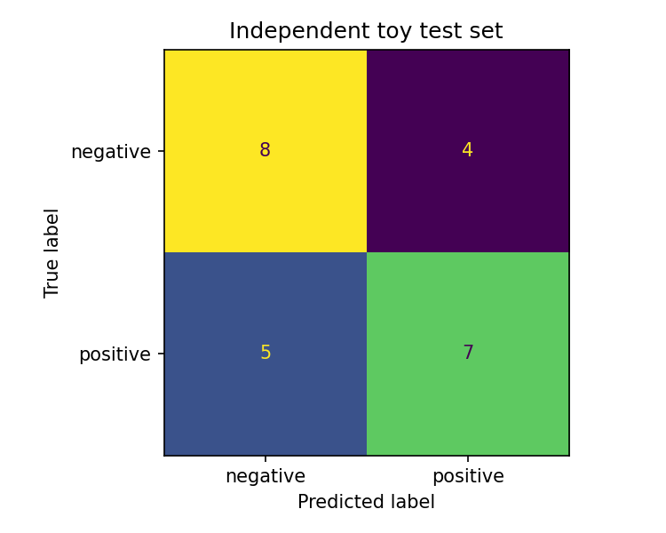

# 本次运行结果

由 `main.py` 实际运行后生成。重新运行可能随依赖版本略有变化。
教学或模拟数据指标不代表真实业务效果。

```json
{
  "tfidf_logistic_regression": {
    "accuracy": 0.625,
    "positive_f1": 0.6086956521739131,
    "macro_f1": 0.6243478260869566
  },
  "majority_baseline": {
    "accuracy": 0.5,
    "positive_f1": 0.0,
    "macro_f1": 0.3333333333333333
  }
}
```



完整输出：[`outputs/metrics.json`](outputs/metrics.json)。
